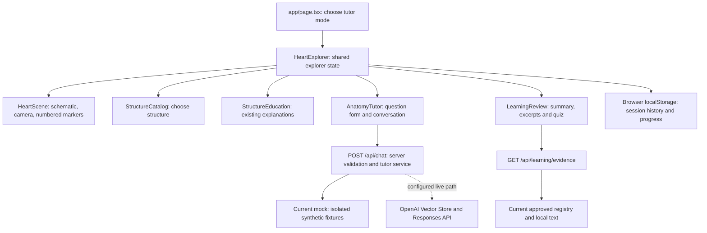
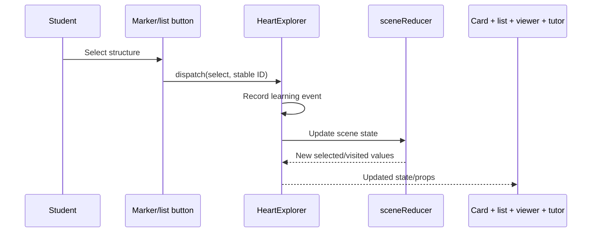

# Beginner’s Guide to the Heart Anatomy Website

**Code inspected and guide written: 12 October 2026.** This describes the saved working files in `C:\Users\Jie Hui\Documents\WebsiteProjects\heart-anatomy-site`, on `feature/website-improvements`. It includes the completed learning-session, summary, Word-export and quiz implementation. This documentation task does not change website functionality.

## How to study this guide

Start with sections 1–3. Open the website while reading section 4 and try the controls. Study sections 5–7 for your research presentation. Section 8 explains your development tools; section 10 provides presentation scripts.

“Implemented” means the code exists. “Tested” means a stated check was run. Neither means that medical accuracy, educational effectiveness, accessibility on every device, or production security has been established.

### What was checked before writing

- The preceding implementation finished before this guide began. Its TypeScript check, ESLint check and final production build passed. The build includes `/`, `/api/chat`, `/api/tutor` and `/api/learning/evidence`.
- The automated test suite passed with 112 tests, including 12 learning-session tests. It was rerun during the documentation inspection.
- The preceding browser checks passed for learning-session persistence, reference review, quiz feedback/results/retry, Word downloads, progress, panel framing, repeated selection, manual camera interaction and responsive layouts. The learning browser test intercepted the tutor endpoint with a labelled mock response; it did not test OpenAI.
- Word opened earlier fixture and browser-export documents, and exported pages were visually inspected. The final summary text was subsequently deduplicated and retested; its final browser download passed. Do not interpret this as a visual inspection of every possible exported session or every Word version.
- During this inspection, the real local evidence endpoint returned 77 source records, 27 available sources, 13 excerpt mappings and eight practice gaps. The real chat endpoint returned a mock insufficient-evidence response to the proximal-LAD example.
- The approved local coronary-sinus search returned passages and `possible-support-needs-review`. The exact proximal-LAD example returned no eligible local passages. Neither diagnostic establishes scientific sufficiency.
- The source registry validated. No OpenAI calls, document uploads, scientific approvals or website code changes were made for this guide.

Changes are saved on disk but are **not committed**. Both `main` and `feature/website-improvements` currently point to the same saved Git commit; the developing website includes many uncommitted working files. Being on a feature branch alone does not back up those files.

## 1. Your website in plain English

Your website is an interactive cardiovascular teaching workspace. A student explores a schematic heart, chooses one of 17 numbered structures, reads an explanation at one of three levels, and can open a tutor beside the model. It also records local learning activity, lets the student review approved reference excerpts, exports a Word summary and offers source-based practice questions.

Think of it as three connected workstations:

1. **Explorer:** the heart, markers, structure list, information card and progress display.
2. **Evidence and tutor:** the reference catalogue, local search tools and chatbot request pipeline.
3. **Learning review:** the student’s activity record, reviewed passages, summary and practice quiz.

The heart is currently a **six-shape schematic**, not a final anatomical coronary model. The 17 labels have approximate anatomical anchors; most do not have their own vessel geometry. The current tutor is a **mock preview**, not an AI giving medical explanations. Approved real sources are searchable through the local tools and used by the learning-review evidence endpoint; they are not silently substituted into the mock chatbot.

### The technologies and their jobs

Versions below reflect `package.json` declarations, not a claim that every dependency uses an exact locked version. `^` allows compatible updates; `package-lock.json` records the installed dependency tree.

| Technology | Beginner explanation | Actual job here |
| --- | --- | --- |
| Next.js 16.3.1 | The organiser that builds and serves the website | Provides pages, server endpoints, development server and production build |
| React / React DOM 19.2.8 | Builds the interface from reusable pieces called components | Updates buttons, cards, panels and conversations when data changes |
| TypeScript 5 series | JavaScript with descriptions of the kinds of data allowed | Helps catch wrong IDs, missing fields and incompatible values before running |
| Tailwind CSS 4 series | A styling toolkit | Supplies CSS processing and utilities; much of this design is also custom CSS in `app/globals.css` |
| Three.js 0.185 series | A 3D drawing engine | Represents meshes, materials, lights, camera positions and transformations |
| React Three Fiber 9.7 series | Connects React components to Three.js | Provides `Canvas`, frame callbacks and React-style scene construction |
| Drei 10.7 series | Ready-made helpers for that connection | Supplies `OrbitControls` and `useGLTF` |
| OpenAI SDK 7.32 series | A library for communicating with OpenAI | Implements the optional server-side live retrieval/generation and indexing adapters |
| Zod 4.6 series | Checks that incoming data has the required shape | Validates chat messages, saved sessions and curated metadata |
| docx 9.10 series | Creates Word documents | Builds `.docx` summaries locally in the browser |
| ESLint 9 series | Checks code for common problems | Runs through `npm run lint` |

`.tsx` files contain TypeScript plus JSX: HTML-like notation used to describe React components. `.ts` usually contains data and logic. `.mjs` is JavaScript used for scripts and tests. Python `.py` scripts perform reference extraction and metadata collection. JSON files store structured data. CSS controls appearance and layout.

## 2. The overall architecture

The **frontend** is the part running in the student’s browser: the visible interface and interactions. The **backend** is the server-side part that accepts requests, reads approved files and, if enabled, communicates with external services.

Both live in the same Next.js project. There is no separate Express application or account database in this implementation.



**Props** are values a parent component gives its children. For example, `HeartExplorer` gives the selected structure and level to the card and tutor. Children request changes through callbacks, such as `dispatch({ type: "select", id })`. The parent updates shared state, and React refreshes the relevant interface pieces.

The information card reads `EDUCATION` directly. Opening a card does **not** call an AI or run RAG. The tutor sends a JSON request to a backend route. JSON is a standard text format for passing structured information, such as a question together with a structure ID.

`app/page.tsx` and `app/layout.tsx` are server components. Interactive components declare `"use client"`. The 3D scene is dynamically loaded with server rendering disabled because graphics need the browser. “Dynamically loaded” means loading a larger part when required, rather than placing it all in the initial bundle. Review and Word export also use delayed loading.

The API key belongs on the server, never in browser code. The saved local configuration template is `.env.example`; it defaults to mock mode. The live adapters are implemented, but the current index manifest is empty and external indexing clearance is zero.

## 3. Finding your files

The root folder is:

```text
C:\Users\Jie Hui\Documents\WebsiteProjects\heart-anatomy-site
├── app/                 Page, shared styling and server endpoints
├── components/          Visible interface and 3D components
├── lib/                 Reusable logic and anatomical data
│   ├── knowledge-base/  Reference validation, approval and collections
│   ├── tutor/           Retrieval and chatbot processing
│   └── learning/        Sessions, summaries, evidence and quizzes
├── knowledge-base/      Registry files and reference documents
│   ├── approved/        Approved extracted local documents
│   ├── pending_review/  Historical unapproved teaching files
│   ├── collections/     Staged/activated collection snapshots
│   ├── imports/         Imported lists and verified metadata cache
│   └── archive/         Earlier registry and index snapshots
├── scripts/             Commands for importing, reviewing and searching
├── tests/               Automated and browser checks; isolated fixtures
├── docs/                Reports and guides, including this guide
├── public/              Static files; currently mostly template SVGs
├── package.json         Dependencies and named commands
├── package-lock.json    Exact dependency installation record
├── node_modules/        Installed libraries: generated, do not edit
└── .next/               Next.js build/dev output: generated, do not edit
```

### Essential entry points and content

Click these paths to locate the files. In VS Code, Ctrl+P also lets you type the short filename.

| File | Responsibility and important names | Normally edit it? |
| --- | --- | --- |
| [app/page.tsx](<C:/Users/Jie Hui/Documents/WebsiteProjects/heart-anatomy-site/app/page.tsx>) | `Home` reads tutor mode and opens `HeartExplorer` | For page entry/configuration changes |
| [app/layout.tsx](<C:/Users/Jie Hui/Documents/WebsiteProjects/heart-anatomy-site/app/layout.tsx>) | `RootLayout`, page metadata and Geist fonts | For whole-site metadata/layout changes |
| [app/globals.css](<C:/Users/Jie Hui/Documents/WebsiteProjects/heart-anatomy-site/app/globals.css>) | Full-screen shell, panels, responsive styles, marker/quiz appearance | For appearance/layout changes |
| [HeartExplorer.tsx](<C:/Users/Jie Hui/Documents/WebsiteProjects/heart-anatomy-site/components/HeartExplorer.tsx>) | Main coordinator; tracked `dispatch`, `questionAsked`, `replyReceived`, `returnToModel`, `clearSaved` | Carefully, for feature integration |
| [heart-parts.ts](<C:/Users/Jie Hui/Documents/WebsiteProjects/heart-anatomy-site/lib/heart-parts.ts>) | `HEART_PARTS`, `STRUCTURE_GROUPS`, `getHeartPart`; canonical inventory | Preserve IDs; change only deliberately |
| [education.ts](<C:/Users/Jie Hui/Documents/WebsiteProjects/heart-anatomy-site/lib/education.ts>) | `EDUCATION`, `REFERENCES`, `LEARNING_LEVELS`; 51 explanations, flow routes and links | For reviewed educational wording |
| [scene-state.ts](<C:/Users/Jie Hui/Documents/WebsiteProjects/heart-anatomy-site/lib/scene-state.ts>) | `INITIAL_SCENE`, `sceneReducer`; shared interaction memory | For shared interaction rules |

### Viewer, marker and panel files

- [HeartScene.tsx](<C:/Users/Jie Hui/Documents/WebsiteProjects/heart-anatomy-site/components/HeartScene.tsx>): `Canvas`, lighting, model, camera, projector, pointer-drag detection and graphics failure handling. It brings the 3D pieces together.
- [SchematicHeart.tsx](<C:/Users/Jie Hui/Documents/WebsiteProjects/heart-anatomy-site/components/SchematicHeart.tsx>) and [heart-model.ts](<C:/Users/Jie Hui/Documents/WebsiteProjects/heart-anatomy-site/lib/heart-model.ts>): create spheres/cylinders from `SCHEMATIC_PARTS`; define default camera/target and `ANATOMICAL_MODEL_URL` (currently `null`). Edit these for model configuration, not educational paragraphs.
- [ImportedHeart.tsx](<C:/Users/Jie Hui/Documents/WebsiteProjects/heart-anatomy-site/components/ImportedHeart.tsx>): optional `useGLTF` loader, named-mesh picking, cloned materials, highlighting and isolation. It exists but is inactive and was not tested with a final anatomical asset.
- [marker-anchors.ts](<C:/Users/Jie Hui/Documents/WebsiteProjects/heart-anatomy-site/lib/marker-anchors.ts>), [MarkerAnchors.tsx](<C:/Users/Jie Hui/Documents/WebsiteProjects/heart-anatomy-site/components/MarkerAnchors.tsx>) and [model-registry.ts](<C:/Users/Jie Hui/Documents/WebsiteProjects/heart-anatomy-site/lib/model-registry.ts>): separate anatomical IDs from 3D positions and mesh objects. Coordinates require anatomical/model review before replacement.
- [HeartAnnotations.tsx](<C:/Users/Jie Hui/Documents/WebsiteProjects/heart-anatomy-site/components/HeartAnnotations.tsx>): HTML marker buttons and `AnnotationProjector`. [marker-layout.ts](<C:/Users/Jie Hui/Documents/WebsiteProjects/heart-anatomy-site/lib/marker-layout.ts>) supplies `placeMarkers` to reduce overlap.
- [HeartCamera.tsx](<C:/Users/Jie Hui/Documents/WebsiteProjects/heart-anatomy-site/components/HeartCamera.tsx>), [usePanelMeasurements.ts](<C:/Users/Jie Hui/Documents/WebsiteProjects/heart-anatomy-site/components/usePanelMeasurements.ts>), [model-screen-bounds.ts](<C:/Users/Jie Hui/Documents/WebsiteProjects/heart-anatomy-site/lib/model-screen-bounds.ts>) and [panel-framing.ts](<C:/Users/Jie Hui/Documents/WebsiteProjects/heart-anatomy-site/lib/panel-framing.ts>): measure occupied space, compute visible model bounds and apply one optical shift per meaningful layout change.
- [FloatingStructureEducation.tsx](<C:/Users/Jie Hui/Documents/WebsiteProjects/heart-anatomy-site/components/FloatingStructureEducation.tsx>) with [stable-card-layout.ts](<C:/Users/Jie Hui/Documents/WebsiteProjects/heart-anatomy-site/lib/stable-card-layout.ts>): `dockInformationCard` keeps the card on a stable side/sheet and updates its SVG connecting line.
- [StructureEducation.tsx](<C:/Users/Jie Hui/Documents/WebsiteProjects/heart-anatomy-site/components/StructureEducation.tsx>), [StructureCatalog.tsx](<C:/Users/Jie Hui/Documents/WebsiteProjects/heart-anatomy-site/components/StructureCatalog.tsx>), [LearningLevelControls.tsx](<C:/Users/Jie Hui/Documents/WebsiteProjects/heart-anatomy-site/components/LearningLevelControls.tsx>) and [SceneControls.tsx](<C:/Users/Jie Hui/Documents/WebsiteProjects/heart-anatomy-site/components/SceneControls.tsx>): card, grouped navigation, difficulty buttons/select and viewer controls.
- [ExplorationProgress.tsx](<C:/Users/Jie Hui/Documents/WebsiteProjects/heart-anatomy-site/components/ExplorationProgress.tsx>) and [exploration-progress.ts](<C:/Users/Jie Hui/Documents/WebsiteProjects/heart-anatomy-site/lib/exploration-progress.ts>): `achievementReducer`, `explorationMilestones`; page-local progress and milestone notifications.
- [SceneBoundary.tsx](<C:/Users/Jie Hui/Documents/WebsiteProjects/heart-anatomy-site/components/SceneBoundary.tsx>): an error boundary, a component that shows an alternative when the 3D component fails.

Some earlier helpers remain: `annotation-layout.ts` and `placeInformationCard` in `information-card-layout.ts` have tests but are not the active marker/card positioning algorithms. The stable card uses types from `information-card-layout.ts`; the active placement function is `dockInformationCard`. A file existing does not mean the current screen executes it.

### Tutor, reference and learning files

- [AnatomyTutor.tsx](<C:/Users/Jie Hui/Documents/WebsiteProjects/heart-anatomy-site/components/AnatomyTutor.tsx>): `send`, `submit`, `reset`; chat display, privacy confirmation and request handling. `TutorIcon.tsx` draws its reusable icon.
- [app/api/chat/route.ts](<C:/Users/Jie Hui/Documents/WebsiteProjects/heart-anatomy-site/app/api/chat/route.ts>): POST endpoint. [app/api/tutor/route.ts](<C:/Users/Jie Hui/Documents/WebsiteProjects/heart-anatomy-site/app/api/tutor/route.ts>) reuses it for backwards compatibility.
- [lib/tutor/http.ts](<C:/Users/Jie Hui/Documents/WebsiteProjects/heart-anatomy-site/lib/tutor/http.ts>): `createChatHandler`; validates HTTP requests and returns safe responses. `schema.ts` defines allowed request/response shapes; `client.ts` checks responses in the browser.
- [lib/tutor/service.ts](<C:/Users/Jie Hui/Documents/WebsiteProjects/heart-anatomy-site/lib/tutor/service.ts>): `answerTutor` chooses mock, disabled or live providers. `config.ts` validates environment settings. `deadline.ts` applies time limits; `limiter.ts` limits total requests.
- [lib/tutor/retrieval.ts](<C:/Users/Jie Hui/Documents/WebsiteProjects/heart-anatomy-site/lib/tutor/retrieval.ts>): `preparedToLocal`, `chunkDocument`, `LocalRetrievalProvider`, `OpenAIRetrievalProvider`. `terminology.ts`, `semantic-concepts.ts` and `question-relevance.ts` support term matching, concept matching and direct-answer ranking. `retrieval-evaluation.ts` reports weak/missing support.
- [lib/knowledge-base/anatomical-synonyms.ts](<C:/Users/Jie Hui/Documents/WebsiteProjects/heart-anatomy-site/lib/knowledge-base/anatomical-synonyms.ts>): separate aliases; it does not rename the website’s vessels.
- [lib/tutor/pipeline.ts](<C:/Users/Jie Hui/Documents/WebsiteProjects/heart-anatomy-site/lib/tutor/pipeline.ts>): `runPipeline`, `assessEvidence`; retrieval, generation and output gates. `generation.ts` contains mock/live generators; `instructions.ts` contains learning-level prompts. `core.ts` contains `validateRequest`, `unsafeQuestion`, `injection`, `processResults`, `validateClaims` and refusal messages. `conversation.ts` bounds transmitted history; `types.ts` describes shared data. `scene-actions.ts` only prepares a validation interface: tutor responses do not control the heart.
- [knowledge-base/registry.json](<C:/Users/Jie Hui/Documents/WebsiteProjects/heart-anatomy-site/knowledge-base/registry.json>): authoritative active reference records. `draft-registry.json` is a separate candidate inventory. `index-manifest.json` records remote index identities; it is currently empty. These are not casual editing files.
- [lib/knowledge-base/registry.ts](<C:/Users/Jie Hui/Documents/WebsiteProjects/heart-anatomy-site/lib/knowledge-base/registry.ts>): `validateReference`, `validateRegistry`, `selectApproved`, `externalIndexingAllowed`. [documents.ts](<C:/Users/Jie Hui/Documents/WebsiteProjects/heart-anatomy-site/lib/knowledge-base/documents.ts>): `loadRegistry`, `prepareDocuments`, `prepareAvailableDocuments`, `metadataHash`, `matchesIndex`, `planIndex`.
- [lib/knowledge-base/collections.ts](<C:/Users/Jie Hui/Documents/WebsiteProjects/heart-anatomy-site/lib/knowledge-base/collections.ts>): `buildCollection`, `stageCollection`, `activateCollection`. `curation.ts` describes detailed source mappings; `coverage.ts` produces older curation-based coverage; `review.ts` prepares review-only inventories. `teaching.ts` validates/renders derivative notes; `approval.ts` validates their explicit approval. `mock.ts` validates synthetic fixtures.
- [useLearningSession.ts](<C:/Users/Jie Hui/Documents/WebsiteProjects/heart-anatomy-site/components/useLearningSession.ts>): loads/saves learning state. [LearningReview.tsx](<C:/Users/Jie Hui/Documents/WebsiteProjects/heart-anatomy-site/components/LearningReview.tsx>) shows summary/excerpts and launches [PersonalisedQuiz.tsx](<C:/Users/Jie Hui/Documents/WebsiteProjects/heart-anatomy-site/components/PersonalisedQuiz.tsx>).
- [lib/learning/session.ts](<C:/Users/Jie Hui/Documents/WebsiteProjects/heart-anatomy-site/lib/learning/session.ts>): event schemas, `appendEvent`, `startSession`, `resumeSession`, `sessionActivity`, `calendarDate`. `persistence.ts` validates storage. `summary.ts` supplies `generateSummary`; `word-export.ts` supplies `summaryDocument` and `downloadSummary`; `quiz.ts` supplies `questionPool`, `selectQuestions`, `validateAnswer`, `scoreQuiz`.
- [lib/learning/evidence-server.ts](<C:/Users/Jie Hui/Documents/WebsiteProjects/heart-anatomy-site/lib/learning/evidence-server.ts>): `loadLearningEvidence`; approved local excerpt catalogue. `evidence.ts` defines citations and `ordinaryTeachingPassage`. [app/api/learning/evidence/route.ts](<C:/Users/Jie Hui/Documents/WebsiteProjects/heart-anatomy-site/app/api/learning/evidence/route.ts>) exposes that catalogue locally. `knowledge-base/quiz-bank.json` is the reviewed question bank and is currently an empty array.

### Scripts, configuration and generated files

Scripts are workshop tools rather than page components. `scripts/fetch-reference-metadata.py` obtains public metadata and permitted text; `extract-reference-list.py` reads the supplied reference list. `reference-collection.mjs` stages/activates collections; `collection-report.mjs` reports them. `local-retrieval-corpus.mjs` loads explicitly chosen approved/candidate/synthetic corpora. `retrieval-inspect.mjs` displays searches; retrieval evaluation scripts produce reports. `knowledge-base.mjs` validates/plans. Teaching-review/report scripts support the historical derivative workflow. `tutor-index.mjs` defaults to a dry run; its `--apply` mode can perform billable uploads. Do not run that mode while simply studying.

Configuration files are `next.config.ts` (Next settings), `tsconfig.json` (TypeScript settings and `@/` shortcut), `eslint.config.mjs` (lint rules), `postcss.config.mjs` (CSS processing), `.gitignore` (files Git should ignore) and `.env.example` (safe configuration template). `AGENTS.md`/`CLAUDE.md` guide coding assistants, not students using the website. `next-env.d.ts`, `tsconfig.tsbuildinfo`, `.next/` and `node_modules/` are generated/managed files; do not hand-edit them. Never put an API key into a public component or commit a secret configuration file.

Older documentation is historical evidence, not always current behaviour. In particular, README text about marker-focused camera panning, an initial selected structure and the `127.0.0.1` preview is outdated for this checked version. Use the current code, this guide and `docs/stable-camera-framing.md` for current framing behaviour. This documentation task leaves those older files unchanged.

## 4. Every current user-facing feature

### 4.1 Opening and navigating the workspace

The header shows learning levels, explored count, **Review Session** and **Ask AI Tutor**. The workspace shows the model and **Heart structures** list. At a fresh page load there is no selected structure, so the anatomical information card is closed; the tutor is also closed. Saved activity can return without automatically reopening those panels.

The page occupies the browser’s dynamic viewport height (`100dvh`). Lists, explanations, chat and review content scroll inside their panels. Responsive CSS changes columns to stacked areas and, on smaller screens, makes the tutor an overlay. This is a full-window layout, not a browser Fullscreen API button. Native buttons/links can be reached with Tab and activated with Enter; buttons also support Space. Touch can select buttons and scroll panels. Keyboard selection and responsive layouts have browser checks, but a full accessibility audit has not been completed.

### 4.2 The interactive 3D heart

`HeartScene` creates a Three.js scene through Fiber’s `Canvas`. Meshes are 3D objects made from **geometry** (shape) and **material** (appearance). Ambient and directional lights illuminate the schematic. Four scaled spheres represent chambers; two cylinders provide aorta/pulmonary-trunk context. Three.js draws a new image as the camera moves, using browser WebGL graphics.

Left drag rotates freely around the heart, including complete vertical turns and upside-down views. Right drag pans without changing the viewing angle; the mouse wheel or touch pinch zooms. The camera uses quaternion rotation and a screen offset for pan, keeping its rotation pivot centred on the heart after repositioning. A six-pixel threshold separates marker clicks from drags. Zoom distance is constrained between 1.6 and 12 scene units. Scene units are not millimetres. See [Free heart navigation](heart-navigation.md).

`HeartScene` distinguishes dragging from clicking using pointer movement and multiple touches. An empty-space click clears selection and isolation; a rotation drag should not accidentally do that. Only the aorta has a selectable mapped mesh. The chamber and pulmonary context shapes are not extra teaching entries.

If loading/rendering fails, `SceneBoundary` presents a reload option while retaining navigation. WebGL loss has a separate message; unsupported graphics has a Canvas fallback. These fallback branches exist in code, but not every hardware failure has been reproduced.

**Final model:** `ANATOMICAL_MODEL_URL` is currently `null`, so `ImportedHeart` is inactive. Replacing it requires a licensed segmented GLB asset, verified mesh names, scale/orientation and reviewed anchors. A GLB is a packaged 3D model file. `useGLTF` can load it, but setting a URL alone cannot invent correct vessel mappings. Stable IDs and teaching text can remain while model/anchor configuration changes. Final anatomical asset quality is unverified.

### 4.3 Numbered markers and navigation

`HEART_PARTS` generates 17 marker buttons and matching list entries. The numbers are teaching labels, **not standard coronary segmentation codes**. The canonical inventory is:

| # | Current name | Stable ID |
| --- | --- | --- |
| 1 | Right Coronary Artery (Proximal) | `right-coronary-proximal` |
| 2 | Right Coronary Artery (Middle) | `right-coronary-middle` |
| 3 | Right Coronary Artery (Distal) | `right-coronary-distal` |
| 4 | Posterior Descending Artery | `posterior-descending-artery` |
| 5 | Left Coronary Artery | `left-coronary-artery` |
| 6 | Left Anterior Descending (Proximal) | `left-anterior-descending-proximal` |
| 7 | Left Anterior Descending (Mid) | `left-anterior-descending-mid` |
| 8 | Left Anterior Descending (Apical) | `left-anterior-descending-apical` |
| 9 | Left Diagonal D1 | `left-diagonal-d1` |
| 10 | Left Diagonal D2 | `left-diagonal-d2` |
| 11 | Left Circumflex Artery | `left-circumflex-artery` |
| 12 | Right Marginal Artery | `right-marginal-artery` |
| 13 | Right Conus Artery | `right-conus-artery` |
| 14 | Left Marginal Artery | `left-marginal-artery` |
| 15 | Ascending Aorta | `ascending-aorta` |
| 16 | Superior Vena Cava | `superior-vena-cava` |
| 17 | Coronary Sinus | `coronary-sinus` |

`MARKER_ANCHORS` stores each approximate `[x,y,z]` position. `MarkerAnchors` registers invisible model-local anchor nodes. `AnnotationProjector` converts their 3D positions into screen coordinates every frame. Think of projecting a point in a room onto a photograph of the room. `placeMarkers` separates overlapping buttons; short SVG lines connect displaced buttons to their anchors. This changes screen layout, not anatomical coordinates. Dashed far-side indicators use a simple behind-model test, not exact surface occlusion.

Hover or keyboard focus highlights the matching marker/list item and reveals the marker name. Hover never replaces selection. Clicking either dispatches the same `select` action, highlighting both and opening the card. The list scrolls its selected entry into view independently. Markers outside the projected view may disappear; the list remains an alternative. Dense/small views cannot guarantee all marker buttons remain visible.

The list groups right coronary branches, left coronary branches and great/venous structures. Its notes qualify the illustrative PDA grouping and left-main meaning. Group membership organises the interface; it does not restrict global reference search or prove universal anatomy.

### 4.4 Anatomical information cards

`getHeartPart(state.selectedId)` finds the structure. `StructureEducation` uses `EDUCATION[selected.id][state.learningLevel]`, then renders the explanation, blood-flow list and original reference links. A new structure or level resets the explanation’s internal scroll to the top.

`FloatingStructureEducation` keeps the card in a stable dock, generally to one side on roomy views and a compact bottom sheet on smaller ones. It is not a label that chases every marker. Its SVG leader line continuously follows the selected projected marker as the heart rotates/zooms. The line is hidden when that projection is unavailable or inside the card. This continuous line update is separate from one-time camera framing.

Use **Close**, click empty scene space, or select another structure. Closing clears selection; switching selection updates content and line while smoothly panning the newly selected marker into the clear viewing area. Links open original reference sites in another tab. Existing card text is authored static educational content; it is not automatically approved RAG material just because it contains references.

### 4.5 Stable automatic positioning

The current system centres **the selected marker** in the clear viewing area. With no selection, it centres the whole heart.

1. `usePanelMeasurements` measures the scene, card and open tutor with actual browser rectangles. Resize and mutation observers schedule coalesced measurements.
2. It increments a layout `revision` for panel open/close or significant geometry changes (greater than half a pixel). Marker movement and chat text alone do not demand a transaction.
3. `modelScreenBounds` projects a bounding box around visible meshes. This is a conservative approximation of the whole model, not exact outline area.
4. `clearFramingRegions` finds clear rectangular viewing regions around panel obstacles; `planFraming` chooses the largest region and computes the selected anchor-to-centre shift, or whole-model centring when unselected.
5. `HeartCamera` animates one `PerspectiveCamera.setViewOffset` adjustment over 420 ms with ease-in/ease-out. This shifts the image optically without physically moving meshes, changing anatomical anchors, rotating the camera or shrinking the model.

The frame callback still measures bounds and updates diagnostics, but it does not repeatedly recentre the heart. Selections and opening/closing/resizing panels trigger a coordinated adjustment. Rapid selections redirect the active transition from its current position. Reduced-motion preferences skip the animation. Manual control starts cancel pending framing; ending a gesture does not trigger a snap-back. **Reset view** clears selection and isolation, closes the information card, and smoothly restores default orientation, distance and zoom. It preserves progress, learning level and tutor visibility. Tutor layout may shrink the canvas on desktop or overlap it on mobile; both are measured.

A very narrow clear region may not fit the heart at the preserved zoom. The algorithm reports limited visibility rather than repeatedly zooming out. During active manual interaction, a layout change may be skipped to avoid overriding the student. Bounding boxes are approximate. Tests verify the stable transactions and interactions, not every future model/device combination.

### 4.6 Levels, isolation and visibility controls

**Basic**, **Intermediate** and **Advanced** dispatch a `level` action. On compact layouts a select menu performs the same action. The card swaps between three separately authored strings; the selected ID remains. Switching level also records session activity and updates tutor context. It does not ask an AI to rewrite the card or add progress for the same structure.

**Isolate Structure** is disabled without selection. Mapped vessels retain their original textures at full opacity while surrounding meshes become 20% opaque; hover and selection add no tint during isolation. For marker-only structures in the schematic fallback, it limits markers while retaining context geometry; it cannot isolate nonexistent coronary meshes. Selecting another entry while isolated switches the isolated subject. Turning isolation off restores normal rendering and highlighting; deselection exits isolation.

**Hide/Show Markers** keeps selection/card but toggles annotations. Hover or keyboard focus reveals marker names. **Reset view** resets the camera and clears the selected structure without erasing exploration, history or learning level. Zoom-in/out actions exist in the camera/reducer contract, but there are no current toolbar zoom buttons; students use wheel/pinch.

### 4.7 Exploration progress

`visitedIds` remembers unique selected IDs. Selecting the same structure again does not increase the count. Hover alone does not count. The progress bar width is `unique visited / 17 × 100`; the caption shows the count rather than claiming knowledge mastery.

Milestones occur at 5, 10, 15 and 17 structures. `achievementReducer` queues notifications; a toast dismisses automatically after about 4.5 seconds plus a short closing transition, or by its close button. Earned milestone IDs live in memory. Refresh clears them, so new exploration can earn each milestone again.

Exploration progress lives in React state for the current page and starts at 0 / 17 on every refresh. The old `heart-anatomy:exploration:v1` storage entry is ignored and left intact. Saved learning sessions, summaries and tutor conversations use their existing separate storage and still restore after refresh. Exploration works even if storage is unavailable.

### 4.8 The AI Anatomy Tutor interface

**Ask AI Tutor** toggles the panel. It shows the current structure and level, welcome suggestions, conversation, textarea and Send button. Opening focuses the textarea; the panel’s Close button or Escape closes it and returns focus to the opener.

Confirm **“My questions contain no personal or patient information.”** before sending. Clicking a suggestion before confirming puts it into the input; after confirming it sends. Enter submits; Shift+Enter starts a new line. Questions are limited to 1,200 characters. Send is disabled for blank questions, missing privacy confirmation, busy requests or disabled mode.

`send` records a safe question, captures its structure/level context, and POSTs to `/api/chat`. It keeps at most 20 visible turns. `boundedConversation` sends only recent successful exchanges: up to six messages and 4,800 total characters, with each message limited to 1,800. Conversation can clarify intent but is not scientific evidence.

While waiting, it says **Checking available evidence…**. Valid responses show status, answer and linked sources/sections if present. `readTutorResponse` checks the response shape and `send` checks matching structure/level. Timeouts/errors appear in that turn. Reset/session-switch cancellation prevents a late response from entering the wrong conversation/session. Closing the panel alone does not erase its conversation. **New Conversation** clears the visible thread and records a reset event while retaining earlier session history. **Mark this topic for revision** adds an explicit study note; it is not an inferred diagnosis of misunderstanding.

The current real endpoint is **mock mode**. It either reports synthetic test routing or insufficient synthetic evidence and explicitly says no anatomical answer was generated. It does not use the 27 real documents to manufacture a mock medical explanation. Disabled mode is unavailable. Live mode is implemented but unconfigured/unverified against OpenAI in this project state. There is no streaming answer display or autonomous scene control.

### 4.9 Review Session, saved learning history and revision notes

**Review Session** opens an internally scrolling workspace and closes the tutor. The original explorer remains mounted but hidden, preserving its camera. **Return to Model**, **Continue Exploring** and explored-structure buttons return to it; structure buttons select the relevant entry.

`useLearningSession` records events: card openings, level changes, explicit passage review, questions, replies/errors, resets, revision notes and quiz activity. `sessionActivity` derives unique structures and other counts from this event list. A visit is not a recorded read; you must explicitly mark a passage reviewed. Saved state includes source/version/passage identities and the session’s timezone.

The Saved session selector plus **Resume Current Session** switches to the selected saved session. **Start New Session** keeps previous sessions, starts an empty activity record, resets the exploration count and milestones, and clears the model selection. **Clear Saved History** first asks for confirmation; confirming clears sessions, chat/quiz records and exploration progress and starts fresh. It cannot be undone through the interface.

History is saved under `heart-anatomy:learning-sessions:v1`, with schema version 1. It survives refresh in the same browser/origin. Corrupt saved records are preserved instead of overwritten; a warning allows temporary in-tab activity. Storage-full/unavailable and another-tab changes block further saves and show warnings. There is no cloud database, authentication, encryption or cross-device sync. Limits are 200 sessions and 10,000 events per session; there is no automatic archival/pruning. Local data is editable by the browser owner and is not trustworthy research-grade server telemetry.

In **Read Supporting Passages**, expand a visited structure’s details, read literal excerpts, follow original URLs and choose the review/quiz level. **Mark Passage Reviewed** records that exact current passage at that level. A missing excerpt shows a gap; the application does not invent one. Type a general topic in **Your revision note** and save it; the summary includes it. This free-text note is not the chat’s privacy filter, so avoid personal/patient details.

### 4.10 Summaries and Word export

`generateSummary` makes a **deterministic activity summary**, meaning the same inputs produce the same result without calling an AI. It includes structures, levels, reviewed excerpts, questions, revision topics, completed quiz results and references. Empty clinical sections are omitted.

It includes educational excerpt text only after explicit review and current citation/version matching. Mock, unsupported and stale replies are excluded from educational notes. A recorded live supported reply is admitted only if its stored status and citations match currently available sources; that check does not independently establish medical truth or protect against locally edited history.

**Download Word** or **Download Updated Summary** loads the `docx` exporter, creates a browser Blob (a file held temporarily in memory), and downloads `Heart_Anatomy_Session_Summary_YYYY-MM-DD.docx`. It uses the session’s local calendar date, headings and clickable source URLs, and the same summary text shown on screen. Export does not upload the session. A busy state/error message exists; long sessions can still produce large files. The current shared review error message can remain visible after a retry because the download function does not clear it on success.

### 4.11 Personalised practice quizzes

From review, choose a level, mark suitable passages reviewed, then click **Take Personalised Quiz** and **Start Personalised Quiz**. Viewing the setup is not an automatic start. Default length is five; ten/fifteen are offered when enough questions exist. With fewer eligible questions, the UI says it will use fewer; with none, it blocks starting.

`questionPool` requires a visited structure and a current exact passage marked reviewed at the requested level. It favours previously missed question IDs, reviewed-bank entries and structures discussed in the tutor. Selection is deterministic and includes multiple question formats where available; it is not an LLM learning your ability.

Current formats are literal excerpt recall (select the structure whose name was masked) and numbered-marker association. Marker practice uses a separate scene and hides names/tooltips/accessibility answer labels. Its clicks do not add exploration progress. It tests teaching-number associations on the schematic, not recognition of anatomically accurate vessel geometry.

Submit an answer, read correct/incorrect feedback with the literal evidence and original citation, then go to Next Question/Show Results. Results show correct count, percentage, answered concepts and missed concepts. You can review incorrect answers, retry missed questions, take another quiz, download the updated summary, review a structure in the model or exit. Reviewing in the model exits the quiz workspace. Partial quiz events are saved, but a page refresh does not resume an unfinished quiz mid-question; only completed attempts become summary scores.

The reviewed bank is empty. Current questions are labelled **source-template practice, not academically reviewed**. Clinical application and calibrated Advanced questions need a reviewed bank; the schema supports them but they are not currently available. Reviewing at Advanced level does not turn a recall question into an Advanced competency assessment.

The narrow practice filter currently produces 13 excerpt mappings for nine structures: PDA, Left Coronary Artery, D1, D2, LCx, Right Conus, Left Marginal, Ascending Aorta and Coronary Sinus. Its eight gaps are the three RCA segments, three LAD regions, Right Marginal and SVC. This is a conservative practice-pool limitation, not proof that the entire 27-document corpus contains no useful mentions of those structures. Filtering is heuristic and excerpt suitability still needs scientific review.

### 4.12 Historical teaching-review interface

[teaching-review.html](<C:/Users/Jie Hui/Documents/WebsiteProjects/heart-anatomy-site/docs/teaching-review.html>) is a separate static review document, not a Next.js page. Open it from Windows File Explorer by double-clicking, or use Open With → your browser. Its search field filters rows; expandable hashes, document links and source URLs support review. It contains scientific uncertainty/gap notes.

It has no built-in comment saving or approval button. Record corrections in a separate reviewer file with structure ID, passage, source/section, suggested correction and reviewer/date. Do not treat **Mark Passage Reviewed** in the student review workspace as scientific approval.

The 17 historical teaching-note records are `pending_review` in the archived registry at `knowledge-base/archive/replacement-2026-10-11-447202a07dbc/registry.json`. Their Markdown files remain under `pending_review/`, but the active 77-source registry does not include them. The static review HTML and older reports are snapshots, not live views of the active collection. Historical approval scripts operating on the active registry will not find these archived note IDs without a deliberate future reintegration workflow. No approval has been applied by this guide.

## 5. How your RAG system works

### 5.1 RAG from the beginning

**Retrieval-Augmented Generation** combines searching for evidence with generating an explanation. Imagine a tutor finding relevant library passages first, then explaining only what those passages support. A **knowledge base** is the organised collection being searched. A **passage** is a smaller piece of a document. A **citation** identifies where evidence came from.

A **large language model (LLM)** generates text. It is different from retrieval: your local search can work without any LLM. Citations, source approval and a high retrieval score do not automatically make a generated answer true.

### 5.2 Current collection and approval gates

The active collection is `replacement-2026-10-11`, activated on 11 October 2026. It has:

- **77 original references marked approved**, with recorded project-owner bulk approval evidence.
- **27 searchable extracted local documents** and **50 metadata-only references**.
- **Zero external-indexing clearances**.
- An empty `index-manifest.json`: `vectorStoreId: null`, `documents: []`.
- Archived earlier records/index; historical derived teaching notes do not become approved simply because their source bibliography was approved.

Metadata records ID, title, publication/institution details, anatomical IDs/topics, URL, local path, source type, approval/reviewer/date, document version/hash, access/licensing and collection details. Unknown information remains null or is flagged; title/author/year should not be invented. Approval states are draft, pending_review, approved and rejected.

**Three different gates:** scientific approval of the original reference, availability/permitted local use of its text, and permission to send it to an external indexing service. Metadata-only sources can have scientific approval while lacking searchable text. Bulk approval is the owner’s recorded decision, not independent proof that every statement is correct.

### 5.3 Importing and preparing documents

The reference-list extraction script reads the supplied list into structured imports. `fetch-reference-metadata.py` uses public source pages and, for PMC articles, Europe PMC XML with an exact PMCID identity check. XML is structured document text with headings and metadata. Its importer retains article-body paragraphs only when an explicit unrestricted CC BY/CC BY-SA licence passes the local policy. Restricted/unknown licences, blocked pages and unextracted websites remain metadata-only. The script makes public network requests when deliberately run; the student question flow does not rerun it.

The importer retains headings, author/title/URL/licence attribution, and avoids generating replacement article summaries. It does not extract every table, figure or PDF page. Missing page numbers remain missing. Its stored check date is currently hard-coded to 11 October 2026: rerunning it in future needs maintenance so a report does not imply a fresh date incorrectly.

`buildCollection` normalises URLs, removes tracking fragments/parameters and groups duplicate URLs or verified DOI identities. A **DOI** is a persistent publication identifier. Grouping merges filing associations/original URLs and avoids counting the same article twice. It stages a candidate collection; activation verifies registry and document integrity, backs up the previous registry/index and resets stale remote indexing. Categories and structure mappings are filing information, not claim verification.

`prepareAvailableDocuments` excludes unapproved/unavailable records and handles failures per source. `prepareDocuments` checks the approved directory, permitted paths, file size/type, exact approved version and SHA-256 fingerprint. A **hash** is a digital fingerprint: an edited file no longer matches approved bytes. That source requires renewed review; its peers can remain available. Metadata changes also affect indexing identity.

### 5.4 Local retrieval: the implementation actually running locally

`preparedToLocal` turns approved text into section-labelled units; collection attribution headers are not claim evidence. Original URLs, titles, source IDs and versions remain attached. `chunkDocument` divides long units into overlapping 1,200-character windows with a 1,000-character step. A stable passage ID combines source/version with a hash of the chunk. Character slicing may cut sentences; this is a limitation, not a sophisticated sentence-aware parser.

`LocalRetrievalProvider` searches the whole supplied approved corpus, across all vessel categories. It does not restrict searches to the current sidebar group. On inspection the 27 documents produced 833 section units, which are then chunked further as needed.

Its relevance logic combines:

1. Normalising anatomical names, synonyms, abbreviations and stable IDs.
2. Matching question words against passage text, with lesser weight for metadata.
3. Matching predefined concept groups such as supply/drainage/dominance.
4. Classifying the requested domain/aspects through `questionProfile`: normal anatomy, physiology, pathology, procedure or variation.
5. Using `passageFit` to favour sentences that directly address the structure and requested aspect; penalising irrelevant case observations for ordinary questions and favouring suitable general descriptions.
6. Removing weak candidates and near-duplicate results; comparisons can add complementary evidence for different targets.

The output has at most six passages with original metadata, literal text, a score, matched terms/concepts, directness diagnostics and warnings. A score is **deterministic relevance, not scientific confidence or probability**. `evaluateSupport` can report insufficient, weak support or possible support needing review; it deliberately reports `sufficientScientificEvidence: false`.

The “semantic” wording in the method name refers to fixed concept rules. There are **no neural embeddings in this local implementation**. Rule-based synonyms improve vocabulary matching but cannot understand every wording or verify a medical claim. Our exact LAD “blockage … dangerous” wording produced no eligible passages; this is a current coverage/query-handling gap to discuss, not an answer to fill from general knowledge.

### 5.5 Context, synonyms and learning levels

The separate synonym dictionary maps alternatives without changing canonical names. Whole RCA/LAD questions remain distinguishable from segment questions. Apical LAD is not automatically distal LAD; OM1/OM2 are not automatically the generic Left Marginal model label. R-PDA/L-PDA preserve origin qualifiers; the third-coronary conus label needs confirmed separate origin. These are deliberate safeguards in terminology resolution, not proof that every source mapping is scientifically settled.

The selected marker supplies context and helps resolve “this artery”. Explicitly named structures can guide a cross-vessel question even when another marker is selected. Metadata context has only a modest local boost and does not create missing facts. Short abbreviations can remain ambiguous in ordinary language despite safeguards such as uppercase `AM` handling.

Levels change static cards immediately. For a configured live LLM, `LEVEL_INSTRUCTIONS` changes explanation style/detail while requiring support at every level. **Local retrieval itself is not level-filtered**: its query contract does not contain a learning-level filter. The learning-review catalogue’s excerpts are offered at all three levels, but each student’s reviewed-at-level record gates quiz eligibility. None of this means that a full scientifically calibrated three-level RAG curriculum has been validated.

### 5.6 Mock, embeddings and OpenAI: keep these distinct

| Approach | Present situation |
| --- | --- |
| Local keyword + concept search over approved documents | Implemented and tested through local CLI/evidence preparation; no API key needed |
| Local neural embedding search | Not implemented; no local vector database/embedding model |
| Synthetic retrieval/mock generation | Current chatbot mode; fixtures isolated from real references; no medical answer |
| OpenAI Vector Store search | Adapter/indexer code exists, but no current store/index or external clearances; not exercised live |
| Actual LLM-generated explanations | Responses API code exists; not currently available or live-tested |
| AI-generated summaries/quiz questions | Not implemented; summaries deterministic, current quiz templates deterministic |

An **embedding** would represent text meaning as a list of numbers for similarity search. The optional OpenAI Vector Store delegates managed indexing/search to OpenAI rather than computing your own local embeddings. The current local concept score is not that technology.

### 5.7 Backend answer generation and citations

`createChatHandler` rejects bad origins, non-JSON/oversized input, invalid structure/level/history or missing privacy confirmation. It applies shared total minute/day limits: locally these are in memory; production live mode requires the configured shared Redis-compatible limiter. These are global limits, not accounts or per-student quotas. Privacy/prompt-injection checks are basic patterns, not complete data-loss prevention.

`answerTutor` chooses providers. In mock mode it constructs `LocalRetrievalProvider` using **synthetic fixtures** plus `MockGenerationProvider`. In live mode it validates configuration, approved files, separate remote permission, exact current hashes/versions/metadata, matching manifest entries and store ID before creating the OpenAI client. No eligible content produces insufficient evidence rather than a fallback to model knowledge.

`runPipeline` validates → retrieves → checks evidence suitability → generates → checks cited claims. `validateClaims` requires existing passage IDs and exact supporting quotes. With live mode, `OpenAIGenerationProvider` makes a structured Responses API generation request, then a second conservative verification request. Both use `store: false`; that setting is not a blanket claim about every provider retention policy. The LLM is told to use supplied passages, preserve qualifications and refuse unsupported aspects. The verifier is still an LLM, not a human scientific approval or guaranteed truth engine.

The server builds displayed citations from retrieved records rather than letting the LLM invent URLs. Responses carry source ID, passage ID, original title/URL, section, version and material kind. The UI renders plain answer text and numbered source links. The live vector adapter currently uses a registry-level section locator, so precision may be weaker than the local original-heading citations. Remote section/page fidelity requires validation before research claims about citation accuracy.

### 5.8 Exact example: proximal LAD, “Why is blockage of this artery dangerous?”

1. The student clicks marker 6 or its list entry. `HeartExplorer.dispatch` records a card opening and sends `select` to `sceneReducer`.
2. `selectedId` becomes `left-anterior-descending-proximal`; `StructureEducation` displays its current-level static text. The opened panel triggers the whole-heart framing transaction.
3. The student opens the tutor, confirms privacy and submits the question. `AnatomyTutor.send` captures that ID and level, saves the question event and sends JSON to `/api/chat`.
4. `createChatHandler` validates it and calls `answerTutor`.
5. **Current observed behaviour:** mock mode searches fictional fixtures. For this exact question, the endpoint returned `insufficient_evidence`, no sources and an explicit “no API call or anatomical answer” message. The UI records/displays that result. It does not explain why the blockage is dangerous.
6. **Separate approved local test:** `rag:inspect` with the same question/selected ID searched 27 real documents but returned no eligible passage. This can help diagnose phrasing/coverage without generating an answer.
7. **Conditional future live execution of existing code:** after permissions, approved content/index and credentials are ready, `OpenAIRetrievalProvider` searches the store using question plus anatomy context. If sufficient evidence is retrieved, the Responses generator and verifier run, then validated text/citations return to the UI. Otherwise it refuses. This path exists in code but was not executed in this inspection.

It would be inaccurate to present a fabricated clinical explanation as this example’s current tutor output.

### 5.9 Running local searches safely

In the project terminal:

```powershell
npm run kb:validate
npm run rag:inspect -- --approved "Where does the coronary sinus drain?"
npm run rag:inspect -- --approved "Why is blockage of this artery dangerous?" left-anterior-descending-proximal
npm run rag:inspect -- --synthetic "RCA" right-coronary-proximal
npm run rag:terms -- "pLAD"
```

The `--` forwards arguments from npm to the script. `--approved` deliberately selects real active approved local material; `--synthetic` deliberately selects fictional fixtures. You can inspect passages, source URLs, relevance and support warnings. Synthetic and reference corpora cannot be mixed in one local provider.

`npm run kb:plan` and `node scripts/tutor-index.mjs` are dry runs by default. Future remote work needs rights clearance, suitable scientific coverage, key/model/store settings, explicit live enablement, indexing with a matching manifest and live answer/citation evaluation. Do not add `--apply` just to test locally: that enables external/billable work.

## 6. React state and communication

**State** is a component’s changing memory. Think of an erasable noticeboard: “selected marker = 6; level = basic; tutor = closed”. A normal local variable alone does not tell React to refresh the screen; a state update does.

`useState` stores individual values, such as `tutorOpen`. `useReducer` groups related values and processes named actions through a function, like `sceneReducer`. A **hook** is a React function that connects a component to state or lifecycle behaviour. `useEffect` performs side effects such as saving history or listening for resize. `useLayoutEffect` places the card before painting where possible. `useRef` holds an object/reference between renders without causing a new render when it changes; this is useful for rapidly updating camera/projection data.

### The explorer noticeboard

`HeartExplorer` owns:

- `state.selectedId`: card, marker, list and tutor context.
- `state.hoveredId`: temporary highlighting, not selection.
- `state.learningLevel`: card text and tutor context.
- `state.isolatedId`, `markersVisible`: viewer display.
- `state.visitedIds`: unique lifetime exploration.
- `state.cameraRequest`: explicit reset/zoom commands with sequence number.
- `tutorOpen`, `reviewOpen`: panel/workspace visibility.
- refs for the selected marker projection, DOM surface, focus targets and framing bridge.



Switching level changes only the relevant reducer field, preserving the selected ID. Closing the card dispatches `select` with `null`. Opening the tutor changes `tutorOpen`; the scene does not need its anatomical coordinates changed.

### Other noticeboards

`AnatomyTutor` owns typed question, privacy checkbox, displayed turns and busy state. `useLearningSession` owns session history, readiness, errors and save-block status. `LearningReview` owns review/quiz view, local review level, fetched catalogue, revision input and export status. `PersonalisedQuiz` owns selected questions, current index, chosen answer, feedback and result view. `ExplorationProgress` owns its toast queue separately from the visited IDs.

There is no React Context provider, Zustand store, Redux store or account database in this implementation. Components mostly share state through props and callbacks. Three.js objects and per-frame DOM positioning use refs to avoid re-rendering the entire interface every frame.

React state normally disappears on refresh. The session effect restores validated history from localStorage; the exploration count and milestones start fresh. Camera orientation, selection, open panels and an unfinished quiz are not restored as a complete scene snapshot. Session conversations can be restored, but the tutor still starts closed.

## 7. A realistic student journey

1. **Open the site:** Next serves the page/shell, React attaches interactions, the 3D module loads and local saved activity is checked. No information card/tutor opens automatically.
2. **See the heart:** Fiber constructs the schematic, lights and camera; the projector positions marker buttons.
3. **Select proximal LAD:** marker/list dispatch updates the shared selected ID, the card and highlights. A unique visit adds progress; a card event enters this session.
4. **Read the card:** authored Basic text, blood flow and links appear. Panel measurements trigger one whole-heart shift into clear space.
5. **Switch Intermediate:** the same structure stays selected; its corresponding text appears and the level/content event is recorded.
6. **Rotate/pan/zoom:** The free camera controller responds; marker positions, occlusion and leader lines update. The camera does not keep recentering the selected marker.
7. **Open the tutor:** it displays current structure/level and changes available layout. Framing accommodates that meaningful change.
8. **Ask the example question:** privacy confirmation enables sending. The server processes the request; current mock mode gives a labelled test/insufficient-evidence result, not a generated medical explanation.
9. **Continue exploring:** select another structure to update the existing card and smoothly centre its marker. Current-page progress counts each structure once.
10. **Review Session:** the explorer becomes hidden and review shows actual activity. The local evidence endpoint prepares approved excerpts. Proximal LAD may show a practice gap; a suitably covered visited structure such as Coronary Sinus can have passages to review.
11. **Mark evidence reviewed and practise:** review a current passage at the chosen level, explicitly start a quiz, submit/see cited feedback and finish to record a score.
12. **Download or return:** export the current deterministic summary to Word, return to the model or start a new session while preserving past sessions. Refresh restores saved history and conversations, resets exploration progress, and does not reopen panels or continue an unfinished quiz.

An actual LLM explanation is a conditional future live-mode step, not part of this observed mock journey.

## 8. VS Code, npm and Git for a complete beginner

### Open, inspect and preview

1. Open VS Code. Choose **File → Open Folder** and select `C:\Users\Jie Hui\Documents\WebsiteProjects\heart-anatomy-site`.
2. The left **Explorer** lists folders. Click a folder arrow, then a file. Ctrl+P searches filenames; Ctrl+Shift+F searches project text. Changes in an editor tab are not saved until Ctrl+S (or configured Auto Save).
3. Open **Terminal → New Terminal**. Check the prompt is inside the project folder. A terminal lets you type commands to tools; it is different from typing code into a file.
4. If dependencies are missing, `npm install` installs libraries listed in the project and can update the lockfile. `npm ci` installs exactly from the lockfile for a reproducible setup, replacing the dependency installation. You normally do not need to reinstall for every text change.
5. Run `npm run dev`. Wait for Ready and open **http://localhost:3000** (or the actual port printed if 3000 is busy). This checked setup should use `localhost`; `127.0.0.1` caused Next development-origin problems in earlier validation.
6. Keep that terminal running. Saved edits normally refresh through Next’s development tooling. To stop this server, click its terminal and press Ctrl+C. If a server is already running, use its URL instead of starting duplicates.

PowerShell installations sometimes require `npm.cmd` instead of `npm` if script execution policy blocks the wrapper. That is not a reason to rewrite your app.

`npm run build` checks/creates production output. `npm run start` serves that built output; it is not the editing preview. Build tooling and font preparation can require downloads depending on the environment. None of these commands automatically publish your website.

### Understanding Git and GitHub

**Git** records versions of files locally. A **commit** is a named saved snapshot. A **branch** points to a line of commits so work can develop separately. **GitHub** can host a remote copy and collaboration; it is not the same thing as Git and committing locally does not automatically upload anything.

You are currently on `feature/website-improvements`, not `main`. Both currently point at the same commit, so the present differences are primarily **uncommitted files**, not extra feature-branch commits. Uncommitted changes can travel when switching compatible branches. Commit/back up intentionally before switching; do not assume branch selection protects unsaved work.

Useful read-only checks:

```powershell
git branch --show-current
git status
git diff
```

To make a future reviewed snapshot: save files, run checks, use VS Code’s Source Control to inspect each changed file, stage only intended files, then enter a clear commit message and commit on the feature branch. “Stage” means choose files for the next snapshot. Do not blindly stage secrets, generated output or unrelated files. Push is a separate remote operation after checking your configured remote and intended destination. This guide does not commit or push your work.

### What not to edit casually

Do not hand-edit generated folders, lockfile dependencies, approval hashes, archived snapshots or a remote index manifest to bypass checks. Avoid changing canonical IDs: many components/data/tests use them as a shared contract. Educational content/anchors need scientific review. Treat `.env` secrets, production settings and `--apply` approval/index commands as deliberate work, not tutorial steps.

### Checking a future change

```powershell
npm test
npm run typecheck
npm run lint
npm run build
```

Tests check specific behaviour; TypeScript checks data compatibility; lint checks common code problems; build checks that production output can be created. They do not certify medical accuracy. Optional existing browser scripts include `tests/learning-session-browser.mjs`, `tests/panel-framing-browser.mjs` and `tests/progress-browser.mjs`. These need a running local server, installed Chrome and the separately cached Playwright tooling; they are not included in `npm test`. Do not present all browser scripts as runnable automatically after a plain dependency installation.

## 9. Honest limitations and future development

### Working and locally tested

The schematic explorer, 17-marker/list synchronisation, 51 explanations, level switching, stable framing, leader lines, unique progress, local session review, excerpt review, deterministic summaries, Word download and practice mechanics have implementation/test evidence. Approved local search and refusal diagnostics work without a key. This is technical validation, not a medical/educational efficacy study.

### Partial or awaiting further work

- **Anatomical realism:** approximate anchors and no real coronary vessel meshes. Segmented final-model loading exists but needs licensed, validated assets and mappings.
- **Live tutoring:** SDK adapters and prompts exist, but the active manifest is empty, external clearance zero and live calls untested. Mock preview cannot teach by generating anatomy answers.
- **Reference completeness:** approval of 77 sources is not availability of 77 texts. Fifty remain metadata-only; question-specific segment/physiology/clinical coverage remains uneven.
- **Scientific governance:** source approval does not approve every extracted use, derivative note or quiz. Rare cases, segment boundaries, variable branches and level calibration require expert review.
- **Quiz assessment:** empty reviewed bank; current source-recall/number associations are not validated clinical application or mastery measures.
- **Session persistence:** on-device editable storage, no account/sync/encryption, finite limits and no mid-quiz restoration. A local revision note is not a scientific reviewer comment workflow.
- **Retrieval:** fixed lexical/concept rules, regex domain cues, short abbreviation ambiguity, character chunks and simple overlap deduplication can miss direct answers or admit irrelevant sentences. The current LAD example demonstrates a weakness.
- **Generation assurance:** exact quotes/citations plus an LLM verifier cannot guarantee truth; human review and held-out medically reviewed evaluations remain necessary.
- **Deployment:** filesystem-based server content needs packaging and read access on the deployment host. Global limits may be shared across all students. Production authentication/privacy, monitoring and user-specific controls remain future work.
- **Performance/maintenance:** evidence preparation rereads/prepares the local corpus for requests instead of a persistent search index; long history/schema validation and large summaries can grow. Frame-based projection is necessary but still consumes graphics resources.
- **Documentation/metadata drift:** historical reports and some helpers describe older workflows; importer check dates need updating when rerun. Current remote citations need finer section validation.
- **Dependencies:** the preceding audit recorded existing Next/tooling advisories (10: nine high, one critical). `docx` was not listed. Those were documented, not resolved through unrelated forced upgrades; review them before deployment.

Useful current companion documents are [personalised learning sessions](<C:/Users/Jie Hui/Documents/WebsiteProjects/heart-anatomy-site/docs/personalised-learning-sessions.md>), [stable camera framing](<C:/Users/Jie Hui/Documents/WebsiteProjects/heart-anatomy-site/docs/stable-camera-framing.md>), [bulk reference workflow](<C:/Users/Jie Hui/Documents/WebsiteProjects/heart-anatomy-site/docs/bulk-reference-workflow.md>) and [local relevance](<C:/Users/Jie Hui/Documents/WebsiteProjects/heart-anatomy-site/docs/local-retrieval-relevance.md>). Read dates/statuses when using older reports.

## 10. How to Explain My Website During My UROPS Presentation

### A. One-minute architecture explanation

“My project is an interactive cardiovascular anatomy learning website built with Next.js, React and TypeScript. React connects the model, structure list, learning levels and information cards through shared state. Three.js renders the schematic heart, with React Three Fiber connecting the scene to React and Drei providing rotation and zoom controls. Seventeen stable structure IDs connect the markers to educational data. The camera smoothly centres the selected marker in the available space when selections or panels change.

“The evidence system keeps source approval, searchable text and external indexing permission separate. Approved local documents can be searched without an API key. The current chatbot is a clearly labelled mock; live OpenAI retrieval and generation are implemented but not activated. Students can also save activity locally, review source excerpts, download Word summaries and take limited source-based practice. The final anatomical model and scientific evaluation remain further work.”

### B. Three-minute walkthrough

“The student starts with a schematic heart and a list of 17 structures. Clicking either a marker or a list entry changes one shared selected ID. That updates the highlight, information card and tutor context together. Basic, Intermediate and Advanced explanations are stored separately, so level changes preserve the selected structure and do not depend on AI generation.

“Marker positions are stored separately from teaching content and mesh mappings. The projector converts their 3D anchors into screen positions as the camera moves. The information card stays in a stable dock, while its leader line follows the selected marker. Panel measurements identify the available viewing region; a single optical camera animation centres the selected marker there. The camera stays still after the transition until another user action changes the selection or layout. Students can continue rotating and zooming normally.

“The website counts unique explored structures during the current page visit and resets that count on refresh. It also records session events such as card openings, questions, explicit passage reviews and completed quiz attempts. The review workspace summarises actual activity; it does not treat clicks as mastery. A local exporter downloads the same summary as a Word document. Quizzes currently use reviewed source excerpts for recall and teaching-number associations. They are clearly distinguished from a future academically reviewed clinical question bank.

“For the tutor, the browser submits a question with the selected structure and learning level to a Next.js server endpoint. The endpoint validates input, privacy confirmation and usage limits. The RAG architecture separates retrieval from answer generation. Our approved local retrieval combines anatomical synonyms, keywords, fixed concept rules and direct-answer ranking across the whole reference corpus. It preserves source IDs, original URLs and section information, penalises unsuitable case reports and flags weak support. Scores are relevance measures, not medical confidence.

“The active collection contains 77 owner-approved original references, but only 27 have eligible local searchable text. External indexing permission remains separate and currently absent. The chatbot therefore runs in synthetic mock mode. The existing live implementation would search an approved matching OpenAI Vector Store, generate passage-grounded claims and run an additional verification request before displaying citations or refusing. That live path has not been evaluated yet. My next research work is expert review of evidence and questions, improved question-specific coverage, final-model integration and evaluation of retrieval, answer quality and learning outcomes.”

### C. Explaining why RAG helps

“A general language model can produce plausible unsupported text. RAG first supplies selected evidence from a controlled reference collection. My architecture preserves where that evidence came from and can refuse when it is insufficient. This makes an answer easier to inspect and constrains its sources. It reduces opportunities for unsupported answers, but does not guarantee correctness. At present, real-reference retrieval is local and testable; generated live anatomical answers are still pending activation and evaluation.”

### D. Ten likely examiner questions

1. **Is this an anatomically accurate 3D coronary model?** No. It is a six-shape schematic with approximate anchors. Only the ascending-aorta label maps to a current selectable mesh. The final segmented model is future integration work.
2. **How does selecting a marker update the rest of the interface?** Marker and list buttons dispatch the same stable ID to the parent’s scene reducer. React passes updated state to the card, list, viewer and tutor.
3. **Do learning levels use AI to rewrite content?** The information cards use 51 stored explanations. Live tutor prompts would change style/detail; current local retrieval is not level-filtered and current quizzes are not clinically calibrated by level.
4. **Why does the model move when panels open?** Actual occupied screen areas are measured. One off-axis projection shift centres visible model bounds in the largest clear region while preserving angle and zoom. It does not chase the marker or move meshes.
5. **What retrieval algorithm do you actually use?** Approved local tools use lexical matches, anatomical synonym normalisation and fixed concept/directness rules. They do not use local neural embeddings. A separate OpenAI Vector Store adapter exists but is not activated.
6. **Does selecting a vessel restrict the evidence search?** No. Search is global; selection adds context, especially for pronouns. It is not evidence and does not prevent cross-vessel searches.
7. **Are all 77 references available for answers?** No. All are marked approved as original references, but only 27 have eligible local text. Fifty are metadata-only, and none is externally indexing-cleared at this snapshot.
8. **How do you know an answer is scientifically correct?** We do not claim that from ranking scores or automated tests. The live design checks exact citations/quotes and uses an LLM verifier, but expert review and medical evaluation remain necessary; live answers have not been tested.
9. **How do you personalise learning and store student activity?** Browser-local events record visited structures, questions, explicit reviewed passages and quiz attempts. Deterministic question selection uses eligible reviewed material and missed/discussed topics. There is no account database or validated adaptive mastery model.
10. **What testing have you completed, and what would you evaluate next?** The 112-test suite, TypeScript, ESLint, production build and specified browser workflows passed. Local real-source searches and mock responses were checked. Next are expert-reviewed retrieval/answer assessments, final-model/interaction validation, accessibility/privacy/deployment review and a properly designed learning-outcome study.

### E. Limitations to say plainly

Use “interactive schematic”, “local concept-based retrieval”, “owner-approved bibliography”, “27 searchable texts”, “mock tutor”, “deterministic activity summary” and “unreviewed source-template practice” when those are what you demonstrate. Avoid claiming a medically validated model, embedding search, live generated explanations, clinical mastery or universal coverage until those have been implemented and evaluated.

For a demo, show marker/list synchronisation, level changes, stable framing, one approved local search and a review/export/practice workflow. If asked the LAD example, show the insufficient-evidence outcome honestly and explain the retrieval improvement/evidence work it motivates.

## 11. Keeping this guide up to date

After a future implementation, update this guide’s date, code/function descriptions, collection counts, tutor mode, model availability and verification record. Read the current files before changing claims. Re-run relevant tests and separate technical success from scientific review. A guide snapshot should never be treated as approval of new anatomical content.
